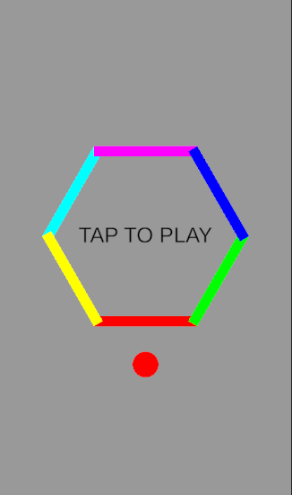

# Hex Bounce

A one-touch color-matching game made with Unity 6. A ball bounces inside a hexagon with six colored edges. Rotate the hexagon so the ball always lands on the edge that matches its color.

**▶ Play in your browser:** [enskrkmz.itch.io/hex-bounce](https://enskrkmz.itch.io/hex-bounce)

## How to Play

| Action | Control |
|---|---|
| Rotate left | Click / tap the left half of the screen |
| Rotate right | Click / tap the right half of the screen |

- The ball must land on the edge with **the same color**. A wrong color ends the game.
- Passing through a color changer gives the ball a new random color.
- Your high score is saved between sessions.

## Features

- Smooth two-step hexagon rotation
- Random color changes during play
- Saved high score
- Works with both mouse and touch (new Input System)

## Built With

- Unity 6 (6000.3 LTS)
- C#
- Unity Input System

## What I Learned

- **ScreenToWorldPoint:** converting the click position on the screen into a position in the game world.
- **Reading the other object's components:** using `GetComponent` on a collision to get the color of the object the ball hit.
- **Physics forces:** making the ball bounce with `AddForce` and `ForceMode2D.Impulse`.
- **Saving a high score** with `PlayerPrefs`.
- **Debugging** with `Debug.Log`.
- **Safe Mode:** getting out of Safe Mode caused by a compile error.
- **New Input System:** reading the click position with `Pointer` to tell the left and right halves of the screen apart; the same code works with mouse and touch.

## Credits

- Inspired by *Bouncing Dot*-style mobile games. This is a learning project and is not affiliated with any original game.
- All code made by me.
